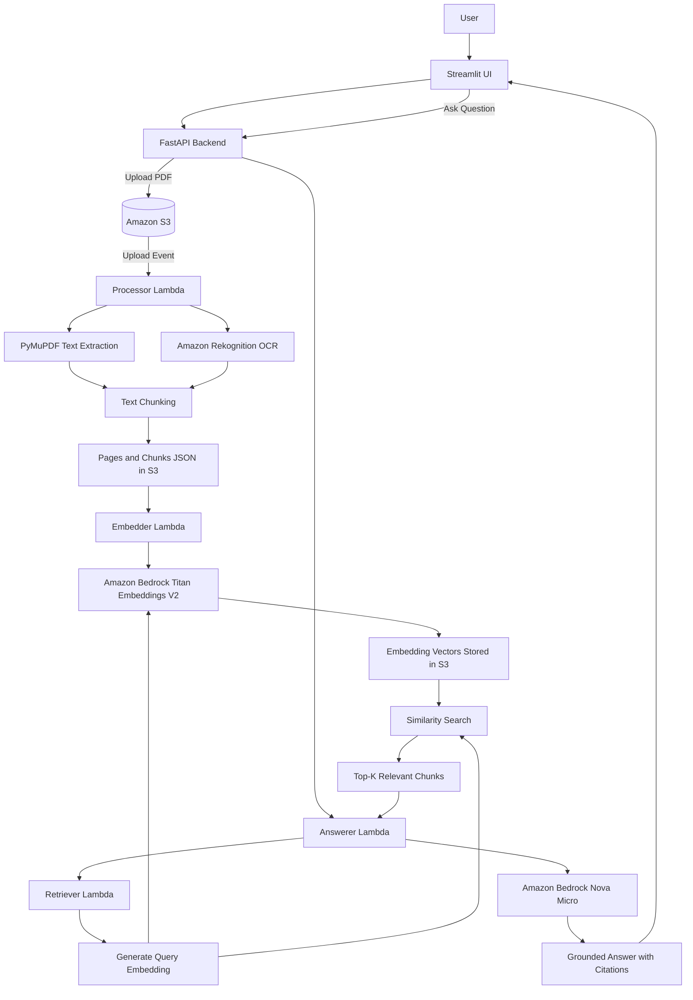

# AWS Document RAG — AI-Powered Document Question Answering

An AI-powered Retrieval-Augmented Generation (RAG) application that allows users to upload PDF documents and ask questions about their contents. The system extracts document text, generates embeddings, retrieves relevant information, and generates context-grounded answers with source citations.

## Architecture

### System Architecture Diagram



### Document Ingestion Workflow

1. The user uploads a PDF through the Streamlit interface.
2. FastAPI uploads the document to Amazon S3.
3. The S3 upload event triggers the processor Lambda.
4. PyMuPDF extracts text from digital PDFs. Amazon Rekognition provides OCR for scanned pages when required.
5. Extracted text is divided into overlapping chunks.
6. Pages and chunks are stored as JSON files in S3.
7. The embedder Lambda generates embeddings using Amazon Bedrock Titan Embeddings V2.
8. The embeddings are stored in S3 for subsequent retrieval.

### Question Answering Workflow

1. The user submits a question through Streamlit.
2. FastAPI invokes the answerer Lambda.
3. The answerer calls the retriever Lambda.
4. Titan Embeddings V2 generates an embedding for the question.
5. The retriever compares the question embedding with stored document vectors using NumPy dot products on normalized vectors.
6. The highest-scoring chunks are returned to the answerer.
7. Nova Micro generates an answer using the retrieved context.
8. The answer and source citations are returned to the user.

## Technology Stack

| Component | Technology |
|---|---|
| Frontend | Streamlit |
| Backend API | FastAPI |
| Cloud storage | Amazon S3 |
| Serverless processing | AWS Lambda |
| PDF text extraction | PyMuPDF |
| OCR | Amazon Rekognition |
| Embeddings | Amazon Bedrock Titan Embeddings V2 |
| Answer generation | Amazon Bedrock Nova Micro |
| Similarity calculation |
| Evaluation | Python and Requests |

## Project Structure

```text
AWS-Document-Rag/
├── app/
│   ├── api.py
│   ├── ui.py
│   └── Lambda_functions/
│       ├── lambda_function_processor.py
│       ├── lambda_function_embedder.py
│       ├── lambda_function_retriever.py
│       └── lambda_function_answerer.py
├── sample_documents/
├── eval.py
├── requirements.txt
├── .gitignore
└── README.md
```

The `sample_documents/` directory is optional. Include only fictional, safe-to-share PDF examples. Adjust the structure above to match the files actually committed to the repository.

## Prerequisites

- Python 3.10 or a compatible version supported by the application dependencies.
- An AWS account with appropriate IAM permissions.
- Access to Amazon S3, AWS Lambda, Amazon Rekognition, and Amazon Bedrock.
- Access to the required Bedrock models in your selected AWS region.
- AWS CLI credentials configured securely, or another supported AWS credential provider.

## Setup and Installation

### 1. Clone the repository

```bash
git clone <YOUR_GITHUB_REPOSITORY_URL>
cd AWS-Document-Rag
```

Replace the placeholder with your actual GitHub repository URL.

### 2. Create a Python environment

Using Conda:

```bash
conda create -n document-rag python=3.10
conda activate document-rag
```

Alternatively, create and activate a Python virtual environment.

### 3. Install dependencies

```bash
pip install -r requirements.txt
```

### 4. Configure AWS

Configure your AWS credentials through the AWS CLI or another supported credential provider.

Set the required environment variables for the FastAPI application, including the AWS region, S3 bucket name, and Lambda function names, according to the application's configuration.

Do not hardcode credentials in the source code or commit `.env` files to GitHub.

Ensure that the Lambda functions, S3 event notification, IAM permissions, and Bedrock model access are configured in AWS before running the complete workflow.

### 5. Start the FastAPI backend

From the project root:

```bash
uvicorn app.api:app --reload
```

Open the API documentation:

`http://127.0.0.1:8000/docs`

### 6. Start the Streamlit frontend

Open a second terminal, activate the same Python environment, and run:

```bash
streamlit run app/ui.py
```

Ensure that the frontend is configured to communicate with the FastAPI backend.

## API Endpoints

| Method | Endpoint | Purpose |
|---|---|---|
| POST | `/upload` | Upload a PDF document |
| GET | `/status/{document_id}` | Check document processing status |
| POST | `/ask` | Ask a question about uploaded documents |

Use `/docs` to inspect the actual request and response schemas.

## Evaluation

Run the evaluation script while the FastAPI backend is running:

```bash
python eval.py
```

The evaluation covers questions about invoice amounts, project status, inventory, scanned documents, and questions whose answers are not present in the uploaded documents.

The current test suite passed **6 out of 6 test cases** in the tested configuration. This is a baseline evaluation result, not a guarantee of accuracy for all documents or questions.

## Retrieval Design

Document chunks and embeddings are stored as JSON objects in Amazon S3. The retriever loads available embedding files, validates vector dimensions, normalizes vectors, and ranks chunks by dot-product similarity.

Because the vectors are normalized, their dot product is equivalent to cosine similarity. The retriever returns the highest-ranked chunks to support answer generation.

This implementation does not use a dedicated vector database. A vector index may be appropriate if the document collection grows significantly.

## Security and Cost Considerations

- Never commit AWS credentials, secret keys, or private documents.
- Apply least-privilege IAM permissions.
- Restrict access to the S3 bucket and application resources.
- Monitor AWS service usage and charges, especially OCR and model inference.
- Configure appropriate Lambda timeouts, memory limits, and error handling.

