# AWS Document RAG — AI-Powered Document Question Answering

An AI-powered Retrieval-Augmented Generation (RAG) application that allows users to upload PDF documents and ask questions about their contents. The system extracts text from digital and scanned PDFs, generates embeddings, retrieves relevant information, and produces context-grounded answers with source citations.

## Architecture

### System Architecture Diagram

```mermaid
flowchart LR
    subgraph ING["Document Ingestion"]
        direction LR
        U["PDF Upload"] --> API["Streamlit UI<br/>+ FastAPI"]
        API --> S3[("Amazon S3<br/>Uploaded PDF")]
        S3 --> P["Processor Lambda"]
        P --> EXT["PyMuPDF<br/>Text Extraction"]
        P -. "Scanned pages" .-> OCR["Amazon Rekognition<br/>OCR"]
        EXT --> CH["Text Chunking"]
        OCR --> CH
        CH --> CJ[("Pages and Chunks<br/>JSON in S3")]
        CJ --> E["Embedder Lambda"]
        E --> T["Titan Embeddings V2"]
        T --> V[("Embedding Vectors<br/>JSON in S3")]
    end

    subgraph QA["Question Answering"]
        direction LR
        Q["User Question"] --> API2["FastAPI Backend"]
        API2 --> A["Answerer Lambda"]
        A --> R["Retriever Lambda"]
        R --> QE["Titan Query<br/>Embedding"]
        QE --> SIM["Similarity<br/>Search"]
        V --> SIM
        SIM --> K["Top-K Relevant<br/>Chunks"]
        K --> A
        A --> L["Amazon Bedrock<br/>Nova Micro"]
        L --> ANS["Grounded Answer<br/>with Citations"]
        ANS --> API2
        API2 --> UI["Streamlit UI"]
    end

    classDef storage fill:#dcfce7,stroke:#16a34a,color:#222
    classDef compute fill:#f3e8ff,stroke:#8b5cf6,color:#222
    classDef interface fill:#e0f2fe,stroke:#0284c7,color:#222

    class S3,CJ,V storage
    class P,E,R,A,T,QE,SIM,L compute
    class U,Q,API,API2,UI,ANS interface
```



### Document Ingestion Workflow

1. The user uploads a PDF through the Streamlit interface.
2. FastAPI uploads the PDF to Amazon S3.
3. An S3 upload event triggers the processor Lambda.
4. PyMuPDF extracts text from digital PDFs. Amazon Rekognition OCR is used for scanned pages when required.
5. Extracted text is split into overlapping chunks.
6. Extracted pages and chunks are stored as JSON files in S3.
7. The embedder Lambda generates embeddings using Amazon Bedrock Titan Embeddings V2.
8. The embeddings are stored as JSON in S3 for retrieval.

### Question Answering Workflow

1. The user submits a question through Streamlit.
2. FastAPI invokes the answerer Lambda.
3. The answerer invokes the retriever Lambda.
4. Titan Embeddings V2 generates an embedding for the question.
5. The retriever compares the query vector with stored document vectors using NumPy dot products on normalized embeddings.
6. The highest-scoring chunks are returned to the answerer.
7. Amazon Bedrock Nova Micro generates an answer grounded in the retrieved context.
8. The answer and source citations are returned to the user through FastAPI and Streamlit.

## Technology Stack

| Component | Technology |
|---|---|
| Frontend | Streamlit |
| Backend API | FastAPI |
| Cloud storage | Amazon S3 |
| Serverless processing | AWS Lambda |
| PDF text extraction | PyMuPDF |
| OCR | Amazon Rekognition |
| Embedding model | Amazon Bedrock Titan Embeddings V2 |
| Answer generation | Amazon Bedrock Nova Micro |
| Similarity calculation |
| Evaluation | Python, Requests |

## Project Structure

```text
AWS-Document-Rag/
├── app/
│   ├── api.py
│   ├── ui.py
│   └── Lambda_functions/
│       ├── lambda_function_processor.py
│       ├── lambda_function_embedder.py
│       ├── lambda_function_retriever.py
│       └── lambda_function_answerer.py
├── lambda_embedding_package/
├── sample_documents/
├── eval.py
├── requirements.txt
├── .gitignore
└── README.md
```

The `sample_documents/` folder contains optional sample PDFs for testing. Include only fictional, safe-to-share documents. The `lambda_embedding_package/` folder should be included only if its contents are required for deployment or reproducibility.

## Prerequisites

- Python 3.10 or a compatible version supported by the application dependencies.
- An AWS account with appropriate permissions.
- Access to Amazon S3, AWS Lambda, Amazon Rekognition, and Amazon Bedrock.
- Access to the required Bedrock models in the selected AWS region.
- AWS credentials configured securely through the AWS CLI or another supported credential provider.

## Setup and Installation

### 1. Clone the repository

```bash
git clone <YOUR_GITHUB_REPOSITORY_URL>
cd AWS-Document-Rag
```

Replace the placeholder with your actual GitHub repository URL.

### 2. Create a Python environment

Using Conda:

```bash
conda create -n document-rag python=3.10
conda activate document-rag
```

Alternatively, use Python's built-in `venv`.

### 3. Install dependencies

```bash
pip install -r requirements.txt
```

### 4. Configure AWS

Configure your AWS credentials using the AWS CLI or another supported credential provider.

Configure the AWS region, S3 bucket name, and Lambda function names as required by `app/api.py`.

Ensure that the AWS resources are already configured, including:

- S3 bucket and upload event notification.
- Processor, embedder, retriever, and answerer Lambda functions.
- Appropriate IAM permissions.
- Access to the required Bedrock models.

Do not hardcode credentials in source code or commit `.env` files to GitHub.

### 5. Start the FastAPI backend

From the project root:

```bash
uvicorn app.api:app --reload
```

Open the interactive API documentation:

`http://127.0.0.1:8000/docs`

### 6. Start the Streamlit frontend

Open a second terminal, activate the same environment, and run:

```bash
streamlit run app/ui.py
```

Ensure that the frontend points to the running FastAPI backend.

## API Endpoints

| Method | Endpoint | Purpose |
|---|---|---|
| POST | `/upload` | Upload a PDF document |
| GET | `/status/{document_id}` | Check document processing status |
| POST | `/ask` | Ask a question about uploaded documents |

Refer to `/docs` for the actual request and response schemas.

## Evaluation

Run the evaluation script while the FastAPI backend is running:

```bash
python eval.py
```

The evaluation suite covers invoice amounts, project status, inventory questions, scanned documents, and a question whose answer is not present in the uploaded documents.

The current test suite passed **6 out of 6 test cases** in the tested configuration. This is a baseline result and does not guarantee accuracy for every document or question.

## Retrieval Design

Document chunks and embeddings are stored as JSON objects in Amazon S3. The retriever loads available embedding files, validates vector dimensions, normalizes vectors, and ranks chunks using dot-product similarity.

Because the query and document vectors are normalized, their dot product is equivalent to cosine similarity. The highest-scoring chunks are passed to the answer-generation model.

This implementation does not use a dedicated vector database. Scanning embedding files in S3 is suitable for a small demonstration but may become inefficient as the document collection grows.

## Security and Cost Considerations

- Never commit AWS credentials, secret keys, `.env` files, or private documents.
- Apply least-privilege IAM permissions.
- Restrict access to the S3 bucket and AWS resources.
- Monitor AWS usage and charges, especially OCR and model inference.
- Configure appropriate Lambda timeouts, memory limits, and error handling.
